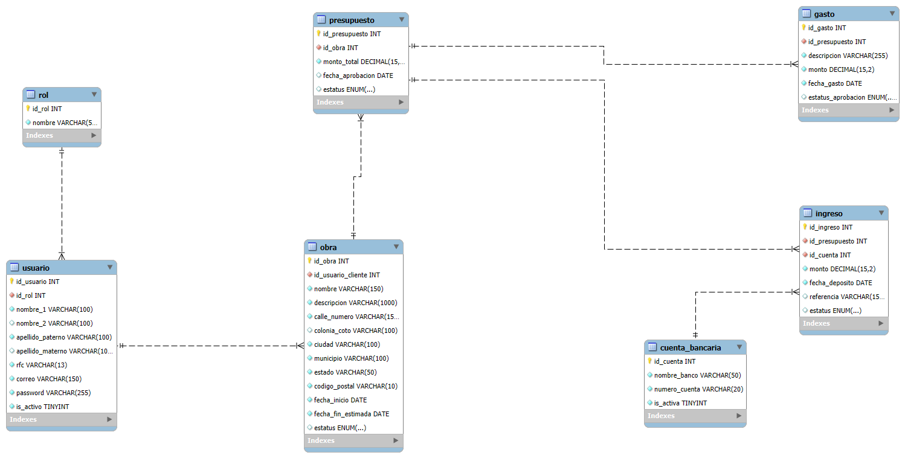

# Sistema de Administración de Obras y Control Presupuestal

> Arquitectura basada en microservicios para la gestión financiera, el control de egresos e ingresos y el seguimiento operativo de proyectos de construcción.

---

## 1. Información General del Proyecto

* **Autores:**
    * Ángel Fernando Hernández Torres
    * Oriol Santiago Álvarez Santacruz
* **Repositorio Oficial:** [ProyectoPrograSistemasWeb](https://github.com/oriolalv00/ProyectoPrograSistemasWeb)
* **Institución / Área:** Ingeniería en Sistemas — Desarrollo de Sistemas Web

---

## 2. Arquitectura y Stack Tecnológico

El sistema sigue una arquitectura desacoplada cliente-servidor respaldada por contenedores para garantizar portabilidad, aislamiento y consistencia entre entornos.

| Capa | Tecnología / Herramienta | Descripción y Responsabilidad |
| :--- | :--- | :--- |
| **Frontend** | HTML5, CSS3, JavaScript (ES Modules) | Interfaz web responsiva tipo SPA con control de vistas por rol y consumo asíncrono mediante `fetch`. |
| **Backend** | Java 17+, Spring Boot 4.1.2 | Microservicio RESTful estructurado en capas (`entity`, `repository`, `service`, `controller`, `exception`). |
| **Persistencia** | Spring Data JPA, Hibernate 7.4 | Mapeo objeto-relacional, validación estricta de esquema (`validate`) y gestión transaccional. |
| **Base de Datos** | MySQL 8.0 (`db_construction_service`) | Motor relacional normalizado en 7 entidades con integridad referencial y codificación `utf8mb4`. |
| **Infraestructura** | Docker y Docker Compose | Orquestación aislada del motor de base de datos y del contenedor del microservicio. |

---

## 3. Especificación de Requerimientos

### 3.1 Requerimientos Funcionales

* **Gestión de Proyectos (Obras):** Permitir el registro, consulta y actualización del estatus operativo de las obras de construcción (`EN_PLANIFICACION`, `ACTIVA`, `PAUSADA`, `TERMINADA`, `CANCELADA`).
* **Control Presupuestal:** Asignar un presupuesto maestro único por obra (relación 1 a 1) y calcular en tiempo real el saldo disponible a partir de los egresos autorizados.
* **Flujo de Aprobación de Gastos:** Permitir que administradores e ingenieros residentes registren egresos operativos en estado `PENDIENTE`, sujetando su impacto financiero a la aprobación o rechazo explícito por parte de un administrador.
* **Conciliación de Ingresos:** Registrar los depósitos y transferencias recibidas de clientes, vinculándolos al presupuesto del proyecto y a la cuenta bancaria destino de la constructora.
* **Administración de Usuarios y Roles:** Gestionar el directorio de usuarios bajo tres perfiles de acceso (`ADMINISTRADOR`, `INGENIERO_RESIDENTE`, `CLIENTE`), aplicando validaciones de formato fiscal (RFC) y borrado lógico mediante bandera de actividad.
* **Portal de Consulta para Clientes:** Proveer una vista exclusiva de solo lectura donde cada cliente visualice únicamente el estado financiero de sus propios proyectos.

### 3.2 Requerimientos No Funcionales

* **Seguridad y Privacidad:** Protección de credenciales en tránsito y en serialización JSON (`WRITE_ONLY`), además de aislamiento estricto de datos por identificador de cliente.
* **Integridad Transaccional:** Garantía de consistencia ACID mediante transacciones declarativas en la capa de servicios y restricciones de llave foránea en base de datos.
* **Manejo Estandarizado de Errores:** Interceptación centralizada de excepciones de negocio para entregar respuestas HTTP semánticas (`400 Bad Request`, `401 Unauthorized`, `404 Not Found`) en formato JSON uniforme.
* **Portabilidad:** Despliegue reproducible mediante contenedores Docker sin dependencias locales específicas del sistema operativo anfitrión.

---

## 4. Casos de Uso Principales

### Caso de Uso 1: Gestión de Obras y Asignación Presupuestal
* **Actor:** Administrador.
* **Descripción:** El administrador inicia sesión en el sistema, registra un nuevo proyecto asociándolo a un cliente activo, captura su ubicación fiscal desglosada y define el presupuesto maestro autorizado.

### Caso de Uso 2: Registro y Autorización de Gastos
* **Actor:** Ingeniero Residente / Administrador.
* **Descripción:** Se captura un gasto de materiales o mano de obra vinculado a un presupuesto vigente, quedando en estado `PENDIENTE`. Posteriormente, el administrador revisa y aprueba el movimiento; el sistema verifica que exista saldo suficiente antes de comprometer el recurso.

### Caso de Uso 3: Registro y Conciliación de Ingresos
* **Actor:** Administrador / Ingeniero Residente.
* **Descripción:** Se documenta un abono recibido por parte del cliente indicando fecha, monto, referencia bancaria, presupuesto destino y cuenta receptora de la constructora.

### Caso de Uso 4: Monitoreo Financiero de Inversión
* **Actor:** Cliente.
* **Descripción:** El cliente accede con sus credenciales a un tablero filtrado automáticamente por su identidad, donde consulta el presupuesto asignado, el monto ejercido y el saldo disponible de sus obras sin permisos de modificación.

---

## 5. Modelo Entidad-Relación

La base de datos `db_construction_service` está diseñada bajo reglas de normalización relacional con **7 entidades principales**:



### Descripción de Entidades

| Entidad | Propósito | Reglas e Integridad |
| :--- | :--- | :--- |
| **`rol`** | Catálogo de perfiles del sistema. | Valores únicos: `ADMINISTRADOR`, `INGENIERO_RESIDENTE`, `CLIENTE`. |
| **`usuario`** | Registro de personal y clientes. | Unicidad en `correo` y `rfc` (13 caracteres). Implementa borrado lógico mediante `is_activo`. |
| **`obra`** | Proyectos de construcción activos e históricos. | Vinculada a un `usuario` cliente. Incluye domicilio desglosado y `codigo_postal` compatible con CFDI 4.0. |
| **`presupuesto`** | Techo financiero autorizado por proyecto. | Relación **1 a 1** (`UNIQUE`) con `obra`. El saldo disponible se calcula dinámicamente. |
| **`gasto`** | Egresos operativos imputados a un presupuesto. | Flujo de estados: `PENDIENTE`, `APROBADO`, `RECHAZADO`. |
| **`cuenta_bancaria`** | Catálogo de cuentas receptoras de la empresa. | Unicidad en `numero_cuenta` y control de vigencia con `is_activa`. |
| **`ingreso`** | Abonos y anticipos recibidos por obra. | Relaciona `presupuesto` con `cuenta_bancaria`. Estados: `PENDIENTE`, `CONCILIADO`, `CANCELADO`. |

---

## 6. Historias de Usuario y Criterios de Aceptación

### Historia 1: Control Presupuestal de Gastos
> **Como** administrador de obra, **quiero** registrar y validar los gastos de materiales en tiempo real **para** mantener un control exacto del presupuesto disponible y evitar sobregiros financieros.

**Criterios de Aceptación:**
* El sistema debe rechazar la aprobación de cualquier gasto cuyo monto exceda el saldo disponible del presupuesto asociado, notificando el motivo al usuario.
* Al aprobarse un gasto, el monto ejercido y el saldo disponible deben actualizarse de forma inmediata en los indicadores del tablero general.

### Historia 2: Consulta Transparente para el Cliente
> **Como** cliente o inversionista, **quiero** consultar el estado financiero de mis proyectos en línea **para** dar seguimiento puntual a la ejecución de mi inversión sin depender de reportes manuales.

**Criterios de Aceptación:**
* La interfaz del cliente debe operar estrictamente en modo de solo lectura, ocultando formularios de alta, edición o aprobación.
* El sistema debe garantizar el aislamiento de información, impidiendo que un cliente visualice obras o presupuestos pertenecientes a terceros.

---

## 7. Guía de Despliegue y Ejecución Local

> **Nota de Seguridad:** Las credenciales de acceso a base de datos y variables de entorno deben gestionarse mediante archivos de configuración locales (`.env` o variables de entorno del contenedor) y nunca exponerse en repositorios públicos.

### 7.1 Inicialización de la Base de Datos

1. Levantar el contenedor de MySQL configurado en `docker-compose.yaml`:
   ```bash
   docker compose up -d mysql_db
   ```
2. Verificar que el esquema inicial (`database/esquema.sql`) se haya ejecutado correctamente. Opcionalmente, cargar el catálogo base de prueba (`database/datos_prueba.sql`) ejecutando el cliente MySQL dentro del contenedor con codificación `utf8mb4`:
   ```bash
   docker cp ./database/datos_prueba.sql mysql_construction_service:/tmp/datos_prueba.sql
   docker exec -i mysql_construction_service sh -c "mysql -u <USUARIO_BD> -p<CONTRASENA_BD> --default-character-set=utf8mb4 < /tmp/datos_prueba.sql"
   ```

### 7.2 Ejecución del Microservicio Backend

1. Verificar los parámetros de conexión en `backend/src/main/resources/application.properties` o mediante variables de entorno de Spring Boot.
2. Compilar e iniciar el servidor embebido desde el directorio `backend/`:
   ```bash
   ./mvnw spring-boot:run
   ```
   El microservicio quedará disponible en `http://localhost:8080/api`.

### 7.3 Acceso a la Interfaz Web

1. Servir el directorio `frontend/` mediante un servidor HTTP local (por ejemplo, Live Server o servidor estático) y abrir `index.html` en el navegador.
2. Autenticarse con una cuenta registrada en la base de datos según el perfil requerido (`ADMINISTRADOR`, `INGENIERO_RESIDENTE` o `CLIENTE`).